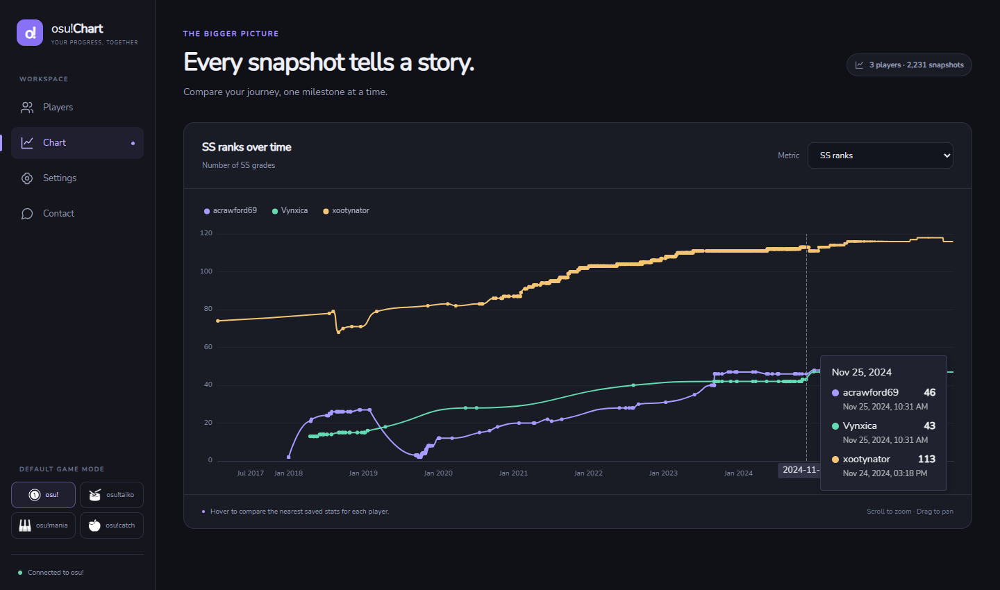
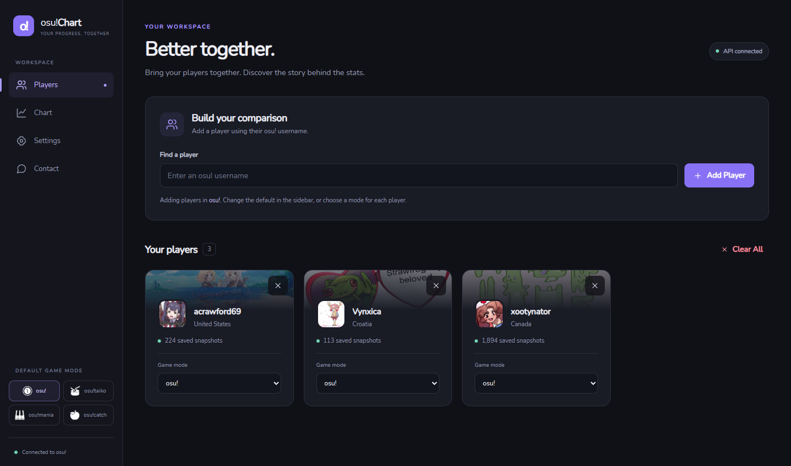
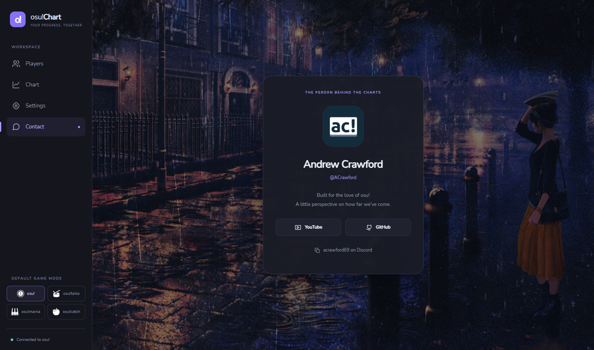

# osu!Chart

Compare osu! players’ progress over time in a desktop app built with Wails, Go, Svelte, and Apache ECharts. Bring your players together, choose a metric, and explore the story behind their saved stats.



## Features

- **Compare multiple players** using historical data from [osu!track](https://ameobea.me/osutrack/) and profiles from the osu! API.
- **Independent nearest-point tooltips.** Every visible player contributes their closest recorded value, even when their saved dates differ. Each row shows its actual observation date.
- **Four game modes:** osu!, osu!taiko, osu!mania, and osu!catch, selectable per player.
- **13 readable metrics**, grouped into Performance, Activity, Grades, and Hit Results: performance points, global rank, accuracy, level, play count, ranked score, total score, SS/S/A grades, and 300/100/50 hit counts.
- **A consistent dark interface** with responsive layouts, bundled typography, and local SVG icons.
- **Interactive charts** with zoom, pan, legend toggles, and a reversed global-rank axis so improving rank moves upward.
- **Recoverable loading and errors:** independent player states, retries, timeouts, and protection against stale responses during mode changes or removal.
- **Safer credential handling:** verify before saving, preserve working credentials on failure, and store configuration outside the served application assets.

History coverage depends on which snapshots osu!track has recorded. The chart displays saved observations rather than interpolating missing tooltip values.

## Screenshots

These screenshots were captured from the running Wails development server with real player data. The credentials page is intentionally omitted.

### Players

Add players, select individual game modes, and see how much history is available.



### Contact

The contact page retains its cursor-responsive parallax background, with animation that settles when idle and cleans up when the page closes.



## Run locally

### Requirements

- Go 1.22 or newer.
- Node.js 22 and npm. Node 22 is recommended for the existing theme-build toolchain; Node 26 is currently incompatible with that toolchain.
- Wails CLI **v2.10.2**, matching the version in `go.mod`.
- Your platform’s [Wails prerequisites](https://v2.wails.io/docs/gettingstarted/installation/), including WebView2 on Windows.

Install the matching CLI if needed:

```sh
go install github.com/wailsapp/wails/v2/cmd/wails@v2.10.2
```

Then clone and start the app:

```sh
git clone https://github.com/acrawford0000/osu-chart.git
cd osu-chart
wails dev
```

Wails starts the Vite frontend and Go backend. Frontend edits update live; Go changes trigger an application rebuild. The browser development endpoint is [localhost:34115](http://localhost:34115).

### Connect to osu!

1. Open **Settings** in the app.
2. Register an OAuth application in your [osu! account settings](https://osu.ppy.sh/home/account/edit#new-oauth-application). Leave the callback URL empty.
3. Enter the Client ID and Client Secret, then select **Save credentials**.
4. Add player usernames on **Players**, then open **Chart** to compare them.

Credentials are kept in the operating system’s user configuration folder. On Windows this is `%APPDATA%\osu-chart\osu_auth_credentials.json`. An existing project-folder credential file is imported automatically, and its original copy is retained. Credential files are excluded from Git.

## Build

```sh
wails build
```

The desktop build is written to `build/bin`.

## Verification

Backend tests, including isolated HTTP failures and credential persistence:

```sh
go test ./...
go test -race ./...
```

Race detection requires a supported C toolchain on Windows.

Frontend tests and production build:

```sh
cd frontend
npm ci
npm test
npm run build
```

The frontend regression suite covers nearest-point selection, score-string conversion, request state, retries, concurrent mode changes, stale responses, credential initialization, and credential saves.

`npm run check` currently reports five pre-existing Svelte 3 / `svelte-routing` component declaration errors. Production builds and runtime navigation have been verified; aligning the router’s types is a planned cleanup before broader dependency upgrades.

## Legacy version

The [legacy branch](https://github.com/acrawford0000/osu-chart/tree/legacy) preserves the original version before the November 2026 modernization. Development continues on `main`.

## License

[GNU General Public License v3.0](LICENSE).
